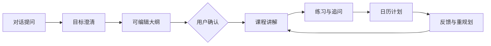

<div align="center">
  

  # Minus

  **Local-first AI learning companion for durable, structured study.**

  把一次提问连接成课程、练习、资料、日历与可持续的学习过程。

  
  
  
  
</div>

## 为什么是 Minus

大模型已经能够快速回答问题，但学习往往在答案生成后中断：知识散落在会话中，讲解、练习和计划彼此割裂，模型建议也缺少明确的写入边界。

Minus 以普通对话为入口，在用户确认学习目标后，把一次提问转化为可编辑、可持久化、可继续调整的学习闭环：



核心原则是：**提议不等于提交，模型输出不等于应用状态。**

## 主要能力

| 能力 | 说明 |
|---|---|
| 多轮对话 | 流式回答、会话历史、消息编辑与重新生成 |
| 深入学习 | 学习意图识别、目标澄清、可编辑大纲与确认式建课 |
| 课程运行时 | 单元讲解、代码示例、练习、追问、来源与学习进度 |
| 资料库 | 本地资料、文件夹、搜索、归档与课程证据增强 |
| 学习日历 | 月历、今日任务、计划草案、冲突校验与伴侣对话调整 |
| Skills / Playbook | 按场景启停、覆盖、排序、预览与恢复 AI 工作规则 |
| 应用内自动化 | 一次、每日、每周、学习事件和闲置触发，支持幂等与有限重试 |
| 安全与审计 | Sandbox-first、危险操作确认、密钥隔离和可配置审计策略 |
| 本机 Agent | 受策略约束的工具执行、暂停、确认、恢复和取消 |

## 技术架构

```text
Next.js App Router + React
        │
        ├── Chat / Course / Library / Calendar / Settings UI
        │
Zustand state stores
        │
        ├── conversation / learning flow / learning data / settings
        │
Next.js Route Handlers
        │
        ├── provider adapter / structured LLM protocol / Zod validation
        │
Domain services
        │
        ├── learning repository / automation / memory / tools / HITL
        │
Local persistence + sandbox boundary
```

### 结构化 AI 输出

模型不会直接修改课程或日历。需要进入业务状态的模型结果会依次经过：

1. 统一模型供应商适配；
2. JSON 协议解析；
3. Zod Schema 运行时校验；
4. 业务规则转换；
5. 用户确认；
6. 本地持久化。

网络、认证、限流、超时和格式错误会分别分类；只有协议格式错误才进行一次受控重试。

### 本地优先的数据层

Minus 当前面向单用户本地运行，学习数据使用结构化 JSON Repository，而不是依赖外部数据库。写入采用临时文件、`fsync` 和原子 `rename`，读取时进行 Schema 校验，并为损坏数据和旧版本迁移保留恢复路径。

API Key 与学习数据分离，不进入浏览器持久化、普通数据备份或审计内容。

### Sandbox 与 HITL

工具执行默认进入隔离环境。网络访问、工作区写入、安装依赖、删除覆盖和对外发布使用不同风险分类；需要副作用的操作会暂停执行并请求用户确认。

提升到本机执行环境不代表自动允许所有危险操作，单次授权也只对当前调用生效。

## 技术栈

- Next.js 16、React 19、TypeScript
- Tailwind CSS v4
- Zustand 5、Zod 4
- Vitest 4、Playwright 1.61
- E2B / Docker sandbox 基础设施
- Windows PowerShell 便携打包脚本

## 本地运行

要求：Node.js 20+，推荐 Windows PowerShell。

```powershell
git clone <your-repository-url>
Set-Location minus
npm.cmd install
Copy-Item .env.example .env.local
npm.cmd run dev
```

打开 [http://localhost:3000](http://localhost:3000)。

至少配置一个模型供应商：

```dotenv
OPENAI_API_KEY=your_key
OPENAI_MODEL=your_model
```

也可以在设置页保存供应商信息。密钥只应保存在本机服务端配置中，不要提交 `.env.local`。

## 常用命令

```powershell
npm.cmd run dev        # 开发服务器
npm.cmd test           # Vitest
npm.cmd run typecheck  # TypeScript
npm.cmd run lint       # ESLint
npm.cmd run build      # 生产构建
npm.cmd run test:e2e   # Playwright 关键流程
```

## Windows 便携包

```powershell
npm.cmd run package:portable:node
```

产物位于 `dist/Minus-Portable/`。便携包使用独立的 `userdata`，默认不会复制开发机上的学习数据或 API Key。

## 项目结构

```text
src/app/          页面、路由与服务端 API
src/components/   产品界面与交互组件
src/lib/agents/   学习编排与结构化模型协议
src/lib/agent/    Agent loop、策略与 HITL
src/lib/learning/ 课程、资料、日历与本地 Repository
src/lib/automation/ 应用运行期自动化
src/store/        Zustand 状态层
src/types/        TypeScript 与 Zod 领域模型
e2e/              Playwright 关键验收流程
skills/           内置 Skills 内容
```

更完整的产品和代码说明：

- [产品约束](PRODUCT.md)
- [项目结构](PROJECT-STRUCTURE.md)

## 当前边界

- 自动化只在 Minus 应用运行时执行，不安装系统后台服务。
- 外部日历双向同步和多设备同步尚未提供。
- 视频路由目前只诚实展示已导入的元数据，不宣称完整播放器能力。
- 模型不可用或输出未通过质量门槛时，不会写入伪课程内容或自动推进学习阶段。

## 安全提示

- 不要提交 `.env.local`、API Key、认证文件或真实用户数据。
- 本机工具默认使用 Sandbox；不要在未理解副作用时提升权限。
- 公开部署前，应另外配置身份认证、速率限制和服务器级数据隔离。

---

Minus is an experimental local-first learning system. It prioritizes explicit user control, structured model outputs and durable learning state over autonomous side effects.
